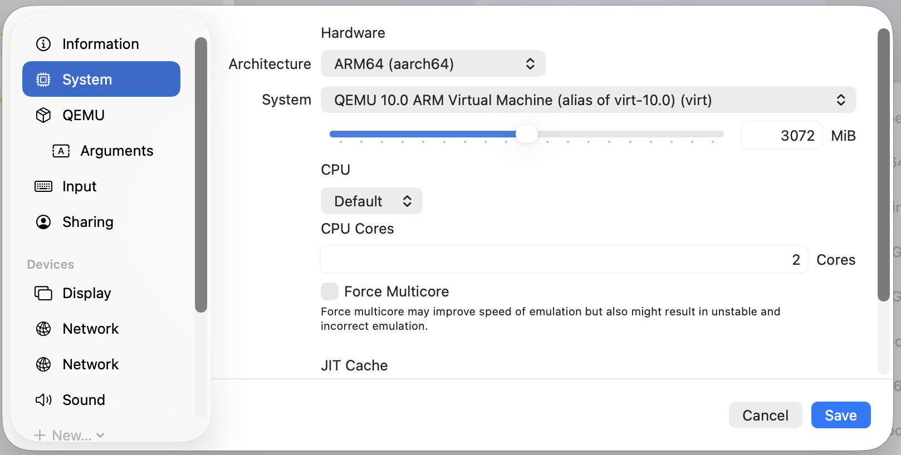
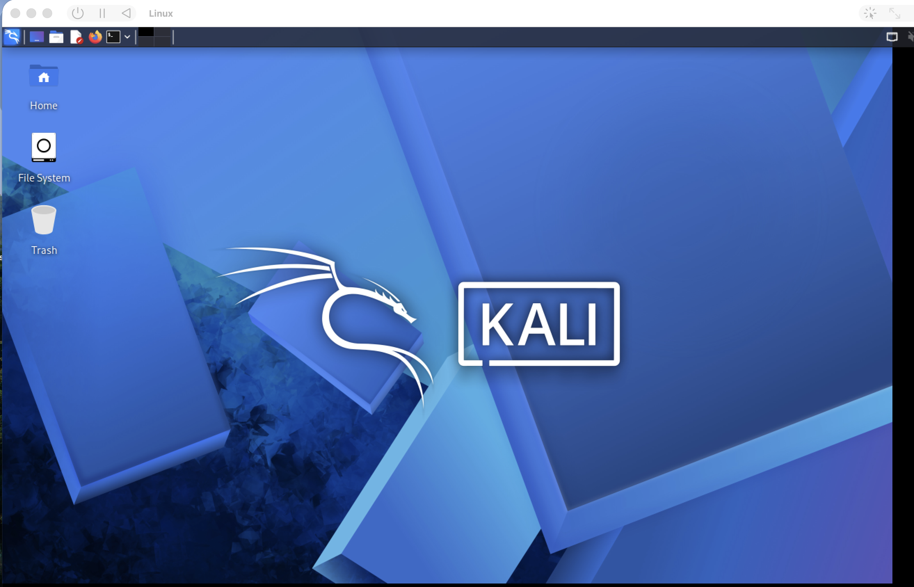
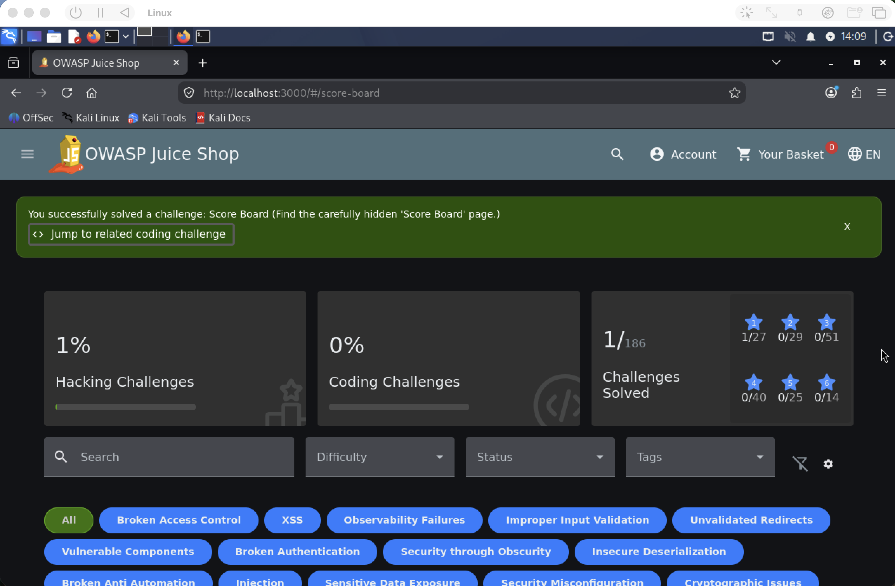

# Semana 1: Armando mi homelab de pentesting en un Mac M2 (y mi primer reto en Juice Shop)


## Por qué un homelab

Quería un lugar donde practicar ataques sin tocar nada que no sea mío. Un homelab es eso: máquinas virtuales en mi computadora, aisladas de mi red, donde puedo romper cosas sin preocuparme realmente de dañar mi equipo.

## Mi equipo y su limitación

- **Máquina:** MacBook con chip Apple M2 y 8 GB de RAM
- **Virtualización:** UTM (motor QEMU)
- **Sistema de ataque:** Kali Linux ARM64

UTM solo puede *virtualizar* sistemas ARM. La mayoría de máquinas vulnerables para practicar (VulnHub, Metasploitable) son x86, y en mi Mac solo se pueden *emular*, que sería más lento.

Por eso mi lab se apoya en tres tipos de objetivos:

1. Contenedores Docker con imagen ARM dentro de Kali (como OWASP Juice Shop).
2. Alguna VM x86 liviana emulada.
3. Plataformas como Hack The Box por VPN, que corren en sus servidores.

Con 8 GB de RAM también decidí correr **una sola VM a la vez**: macOS necesita unos 4 GB.

## Instalando Kali en UTM

Descargué la imagen **Installer** para Apple Silicon (ARM64) desde kali.org.

Configuración de la VM:

| Parámetro | Valor |
|---|---|
| Motor | QEMU (sin "Use Apple Virtualization") |
| Arquitectura | ARM64 |
| RAM | 3 GB |
| CPU | 2 núcleos |
| Disco | 50 GB |



Dejé desmarcada la opción de Apple Virtualization porque el motor QEMU me permite copiar y pegar entre el Mac y Kali, y crear una red *Host Only* para aislar las máquinas.

### El problema: pantalla negra

Al elegir **Graphical install**, la pantalla se quedó negra con un cursor parpadeando. Probé cambiar la tarjeta de video emulada (`virtio-ramfb`, `virtio-gpu-pci`) y también el instalador en modo texto, pero solo conseguí el mensaje *"Display output is not active"*.

Resulta que es un problema conocido entre Kali y UTM. La solución que me funcionó:

1. En **Edit → Devices**, eliminé el **Display** y agregué un dispositivo **Serial**.
2. Arranqué y elegí **Install** (modo texto).
3. Instalé con particionado guiado, todo en una partición. **Evité el cifrado (encrypted LVM)**, porque la contraseña de arranque puede quedar invisible con este problema de pantalla.

Al terminar, antes de reiniciar:

1. Apagué la VM y quité la ISO desde la ventana principal de UTM (**CD/DVD → Clear**).
2. Eliminé el Serial y agregué de nuevo un **Display** con `virtio-gpu-gl-pci`.

Al encender ya entré al escritorio de Kali.



### Después de instalar

```bash
sudo apt update && sudo apt full-upgrade -y
sudo apt install -y spice-vdagent docker.io
sudo systemctl enable --now docker
sudo usermod -aG docker $USER
```

- `spice-vdagent`: copiar y pegar entre el Mac y Kali.
- `docker.io`: para levantar objetivos vulnerables en contenedores.
- `usermod -aG docker`: para usar Docker sin `sudo`.

Después reinicié y **cloné la VM** en UTM. Ese clon es mi Kali "limpio": si rompo algo practicando, lo puedo recuperar sin emepzar todo desde 0.

## La red del lab

Agregué una segunda interfaz de red en modo **Host Only**. Así quedó `ip a` (resumido):

```
1: lo       127.0.0.1        → loopback, la máquina hablándose a sí misma
2: eth0     192.168.64.5     → red Shared: salida a internet por el Mac
3: eth1     192.168.128.2    → red Host Only: red privada del lab
4: docker0  172.17.0.1       → red interna de los contenedores Docker
```

Los experimentos van a vivir en `192.168.128.x`, sin exposición a mi red de casa.

## Primer objetivo: OWASP Juice Shop

Juice Shop es una tienda web hecha a propósito con muchísimas vulnerabilidades.

```bash
docker run -d -p 3000:3000 --name juice-shop bkimminich/juice-shop
```

Luego entré a `http://localhost:3000` desde Firefox en Kali.


## Reto: encontrar el Score Board

El Score Board es una página oculta que lista todos los retos de Juice Shop.

### Lo que no entendía al principio

Siendo honesto: cuando empecé este reto no sabía qué estaba buscando. Abrí las herramientas del navegador (clic derecho → Inspeccionar → **Debugger**).

### Lo que probé

1. Abrí `main.js` y lo formateé con el botón **{ }** para que fuera legible.
2. Busqué `path:` → 56 resultados, ninguno me pareció una ruta.
3. Busqué `"login"` con comillas → 0 resultados.
4. Busqué `login` sin comillas → 99 resultados.
5. Busqué `score` → 71 resultados.
6. Pensé en cómo se escriben normalmente las direcciones web: minúsculas y guiones en lugar de espacios (*kebab-case*). Busqué así el nombre del reto y por fin lo encontré.

Escribí la dirección a mano en el navegador: `http://localhost:3000/#/score-board`



### Lo que entendí después

Una app como Juice Shop no le manda al navegador la página ya hecha. Le manda un paquete de JavaScript que funciona como el **plano completo de la tienda**, y ese plano incluye las direcciones de todas las páginas.

Los desarrolladores "esconden" el Score Board quitando el link, pero su dirección seguía escrita en el código que el navegador ya había descargado.

**La vulnerabilidad:** esconder algo no es lo mismo que protegerlo. A esto se le llama *security through obscurity*.

### Cómo se corrige

- Si una página no debe ser pública, el **servidor** debe verificar quién la pide y negar el acceso a quien no tenga permiso. Quitar el botón no basta.
- Asumir que todo lo que llega al navegador **lo puede leer cualquiera**.

## Lo que aprendí esta semana

- La arquitectura del chip (ARM vs x86) define qué puedo virtualizar.
- Cuando el instalador gráfico falla, el modo texto por consola serial es una salida.
- Cómo se separan las redes de un lab (Shared, Host Only, Docker).
- El navegador descarga el código de la aplicación, y ahí se puede leer más de lo que la interfaz muestra.
- Me falta base sobre cómo funciona la web (HTTP, cliente-servidor). Eso es lo siguiente que voy a estudiar.
