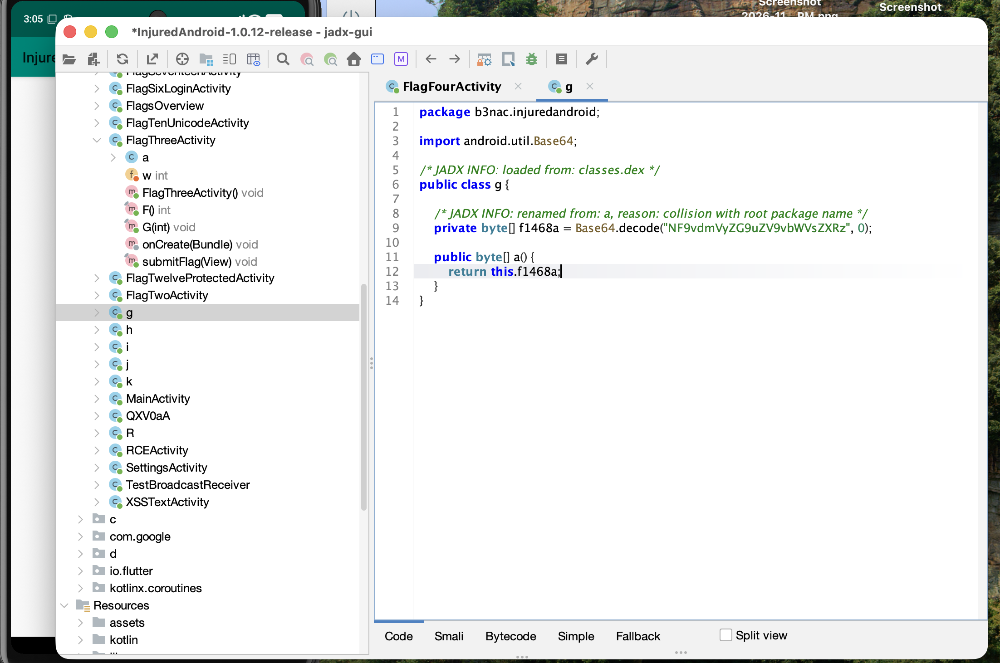
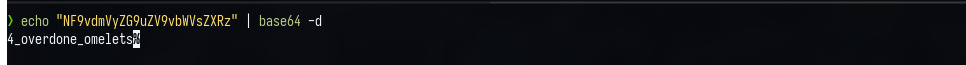

# InjuredAndroid — Flag 4: ofuscación no es protección (seguir una clase)

> Parte de mi serie de writeups de pentesting. Esta flag ya no tiene la respuesta escrita en ningún lado: la app la calcula. Toca seguir el rastro.

## Contexto

Mismo montaje que las flags anteriores: Mac M2, emulador ARM de Android Studio, jadx y adb. App objetivo: [InjuredAndroid](https://github.com/B3nac/InjuredAndroid).

## El reto

Abrí `FlagFourActivity` en jadx y miré su método de envío:

```java
public final void submitFlag(View view) {
    String string = editText.getText().toString();
    byte[] bArrA = new g().a();
    if (d.s.d.g.a(string, new String(bArrA, d.w.c.f2418a))) {
        // pantalla de éxito
    }
}
```

La diferencia con las flags anteriores: aquí no se compara contra un texto fijo ni contra un recurso. La línea `byte[] bArrA = new g().a()` crea un objeto de la clase `g` y llama a su método `a()`, que devuelve unos bytes; esos bytes se convierten en texto y contra ese texto se compara lo que escribo. Es decir, **la respuesta la produce la clase `g`**, no está escrita como tal.

Las pistas de la pantalla lo confirman: *"Where is bob"* y *"Classes and imports"* (esta última apunta directo a mirar una clase).

## Siguiendo la clase

Abrí la clase `g`:

```java
public class g {
    private byte[] f1468a = Base64.decode("NF9vdmVyZG9uZV9vbWVsZXRz", 0);

    public byte[] a() {
        return this.f1468a;
    }
}
```



La "respuesta calculada" resultó ser simplemente un texto en Base64 que la app decodifica al vuelo. Lo revertí yo mismo:

```bash
echo "NF9vdmVyZG9uZV9vbWVsZXRz" | base64 -d
```



**Flag:** `4_overdone_omelets`

## La vulnerabilidad

El concepto de esta flag es la **ofuscación**: disimular un secreto (partirlo en una clase aparte, codificarlo en Base64, calcularlo en vez de escribirlo) creyendo que así queda protegido. No es así. La ofuscación solo agrega pasos para quien busca; no esconde nada de verdad. Seguí el rastro desde la activity hasta la clase `g` y de ahí al Base64, que es exactamente lo que haría un atacante real.

## Cómo se corrige

- Igual que en las flags 1 y 3: un secreto no se protege metiéndolo dentro del APK, por más disimulado que esté. Si viaja en la app, se puede extraer.
- La ofuscación puede usarse para dificultar la ingeniería inversa, pero nunca como único mecanismo para guardar algo sensible.

## Nota: camino alternativo (Firebase)

Esta flag también tiene escondida una URL de una base de datos **Firebase** del reto, mal configurada, que es un segundo camino más avanzado (seguridad en la nube). Lo dejo anotado como posible reto aparte.

## Lo que aprendí

- Que una respuesta puede estar **calculada** en vez de escrita, y hay que seguir el método/clase que la produce.
- A encadenar lo aprendido: leer la activity, seguir una clase, reconocer Base64 y revertirlo.
